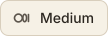
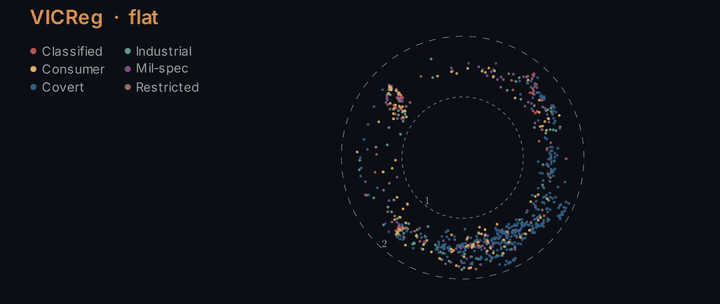

<picture>
  <source media="(prefers-color-scheme: dark)" srcset="assets/header-dark.svg">
  
</picture>

  <a href="https://nessimbena.github.io/"><picture><source media="(prefers-color-scheme: dark)" srcset="assets/links/website-dark.svg"></picture></a>
  <a href="https://scholar.google.com/citations?user=4LWzd3YAAAAJ"><picture><source media="(prefers-color-scheme: dark)" srcset="assets/links/scholar-dark.svg"></picture></a>
  <a href="https://www.alphaxiv.org/@nessim-ben-abbes"><picture><source media="(prefers-color-scheme: dark)" srcset="assets/links/alphaxiv-dark.svg"></picture></a>
  <a href="https://medium.com/@abbesnessim"><picture><source media="(prefers-color-scheme: dark)" srcset="assets/links/medium-dark.svg"></picture></a>
  <a href="https://x.com/NessimBenAbbes"><picture><source media="(prefers-color-scheme: dark)" srcset="assets/links/x-dark.svg"></picture></a>
  <a href="https://www.linkedin.com/in/nessim-ben-abbes-768a98217/"><picture><source media="(prefers-color-scheme: dark)" srcset="assets/links/linkedin-dark.svg"></picture></a>
  <a href="https://bsky.app/profile/nessim.bsky.social"><picture><source media="(prefers-color-scheme: dark)" srcset="assets/links/bluesky-dark.svg"></picture></a>

I'm a CS PhD student at Institut Polytechnique de Paris and an AI engineer at Protectline. I work on the geometry of representation learning, and on vision-language models fast enough for live video.

### Research

<table>
  <tr>
    <td width="48%"></td>
    <td>
      <b><a href="https://arxiv.org/abs/2610.06096">On the Geometry of Multimodal Saturation: Riemannian VICReg</a></b> 
      <b>Nessim Ben Abbes</b>, Duc Han Le, Sabri Mtibaa, Van-Tam Nguyen 
      <i>NeurReps 2026 (PMLR)</i>
      
R-VICReg aligns views by squared geodesic distance on a product of learnable negative-curvature factors, and recovers VICReg as curvature vanishes. Across nine image-text-tabular datasets it raises the probability that a third modality helps from 44.4% to 64.4%.

      <a href="https://arxiv.org/abs/2610.06096">arXiv</a> · <a href="https://www.alphaxiv.org/abs/2610.06096">alphaXiv</a> · <a href="https://github.com/NessimBenA/RiemannianVicreg">code</a>
    </td>
  </tr>
</table>

### Open source

| | |
|---|---|
| **Research code** | |
| [RiemannianVicreg](https://github.com/NessimBenA/RiemannianVicreg) | Code, sweep and results of the R-VICReg paper, with a script that checks every reported number |
| [LLMEvaluationWithGraphs](https://github.com/NessimBenA/LLMEvaluationWithGraphs) | Asks LLMs for a knowledge graph of a subject and ranks them by how connected their graphs are |
| **Tools** | |
| [LLMsOnCLI](https://github.com/NessimBenA/LLMsOnCLI) | Terminal chat for OpenRouter models: streaming replies, vim keys, searchable history, forkable conversations |
| **Earlier work** | |
| [ULTRATHINK-GO](https://github.com/NessimBenA/ULTRATHINK-GO) | A local live feed of what a coding agent does in a repo: commits and TODO.md changes, in the browser |
| [geometric_interpolation](https://github.com/NessimBenA/geometric_interpolation) | Resizes a class region by sliding last-layer weights along a cubic fitted over neuron index |
| [deeply_polynomial](https://github.com/NessimBenA/deeply_polynomial) | One unit that also sees x₁x₂ fits XOR where stacked linear layers fail |
| [Mobilenetv2_Autoencoder](https://github.com/NessimBenA/Mobilenetv2_Autoencoder) | A MobileNetV2-style convolutional autoencoder trained on CIFAR-10 |
| [heat_diffusion](https://github.com/NessimBenA/heat_diffusion) | Lattice-Boltzmann simulation of a heated lid-driven cavity |
| [pathology_pipeline](https://github.com/NessimBenA/pathology_pipeline) | Whole-slide image pipeline for the Mayo Clinic STRIP AI Kaggle competition, with @ThomasPDM |

### Writing

<!-- BLOG-POST-LIST:START -->
- [A New Mathematical Field for a Different Way of Dealing with Problems](https://nessimbena.github.io/blogposts/new-mathematical-field.html)
- [LLMs, AI, and the Sunk Cost Fallacy of Knowledge Acquisition in 2025](https://nessimbena.github.io/blogposts/sunk-cost-fallacy-knowledge-acquisition.html)
- [Mitigating Claude Code Reward Hacking issues](https://nessimbena.github.io/blogposts/mitigating-claude-code-reward-hacking.html)
- [Benchmarking LLMs Through Knowledge Graph Analysis](https://nessimbena.github.io/blogposts/llm-benchmarking.html)
- [AI, LLMs and Software Engineers](https://nessimbena.github.io/blogposts/aisoftwareengineers.html)
<!-- BLOG-POST-LIST:END -->
